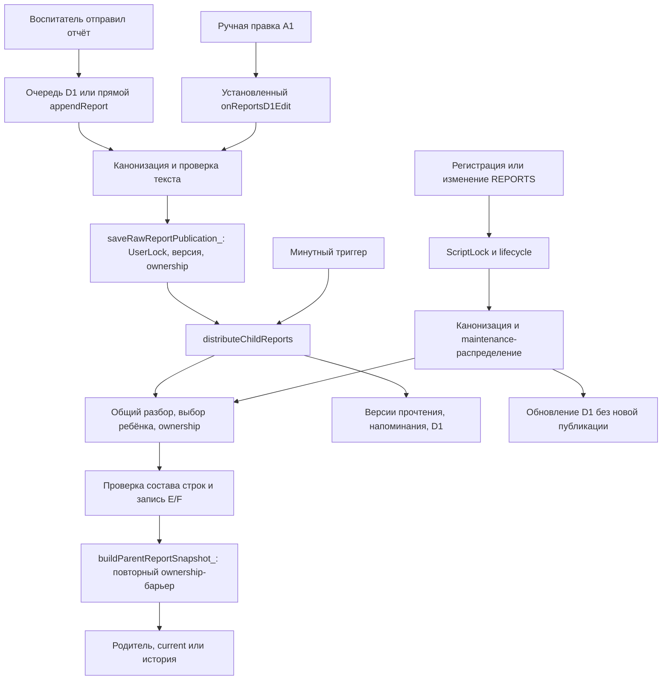

> Актуальное задание после аудита Sol 22.10.2026:
> [план A–E](apps-script-refactor-plan-2026-10-22.md),
> [находки и доказательства](audit/2026-10-22-apps-script-architecture.md).
> Статусы и рекомендации старого аудита ниже исторические; часть уже исправлена.
>
> Реализовано локально 22.10.2026: повторяемая выписка с видимым статусом,
> read-only обогащение родства и общий форматтер строк для двух отчётных путей.
> Поколения/ревизии и сокращение областей блокировок пока не менялись.
>
> Обновление 21.10.2026: прежний Sheets-chat вынесен из исполняемого кода.
> Подробности и актуальный индекс: [chat-retirement](audit/2026-10-21-chat-retirement.md).
> Ниже сохранён исходный аудит до этой чистки; пункт 6 и статус этапа совместимости
> описывают состояние до неё. Ядро отчётов и его архитектурные ограничения сохранены.

## Актуализация 22.10.2026: регистрация и блокировки

После того как Cloudflare подтвердил регистрацию, интерфейс родителя запускает `mirrorCloudflareParentRegistration` фоново и не ждёт его. Адаптер Apps Script не ждёт общий lock и не делает сетевых вызовов: он ставит сигнал в Script Properties и быстро возвращает `pending`. Минутный фоновый retry обрабатывает durable outbox из Cloudflare, а 10-минутная синхронизация остаётся страховочным проходом. Значит, интерфейс родителя не ждёт ни очередь, ни блокировку.

Фоновый обработчик берёт ScriptLock без ожидания (до 1 секунды попытки) только на проверку номера и добавление строки в REPORTS. Если замок занят, запись остаётся в outbox до следующего прохода. Ответ Cloudflare и подтверждение outbox выполняются после освобождения lock. Это закрывает гонку, где мгновенное зеркало и фоновая очередь могли одновременно добавить одну регистрацию.

Выписка уже устроена по тому же принципу: панель воспитателя отправляет запрос напрямую в Worker и ждёт только подтверждения приёма. Worker одной операцией закрывает профиль в D1 и создаёт durable tombstone, после чего возвращает `accepted`; карточка в панели убирается оптимистически. Обработка строки REPORTS, истории чата и S3 запускается через `waitUntil`, а каждую минуту дополнительно подхватывается cron. Apps Script-lock и его сетевые/медленные шаги находятся только внутри этой фоновой очереди, поэтому они не задерживают кнопку воспитателя. Ошибки повторяются; после 12 неудач задача отмечается `failed`, то есть скорость интерфейса не означает, что фоновая очистка уже завершилась.

Остальные длинные критические участки пока сохранены: lifecycle-сверка профилей и обработчик удаления держат ScriptLock вокруг нескольких действий, часть из которых обращается к Cloudflare/Drive. Они могут задержать фоновую синхронизацию, но не экран воспитателя при выписке. Разносить эти действия опасно без durable-пошагового протокола: при сбое можно закрыть профиль в D1, не удалить строку в REPORTS или потерять очередь очистки. Отдельный следующий этап — превратить lifecycle в короткую фиксацию намерения и повторяемые шаги.

# Apps Script: структура, противоречия и безопасное упрощение

21.10.2026. Аудит поверх `0aea538`; отдельная точечная правка ниже. Прочитан актуальный checkout `timeweb-next`, origin совпадал. Реальные отчёты/сообщения не выгружались. Это анализ исходников, а не утверждение о полном покрытии production-настроек.

## Вывод

Упорядочивание нужно. Основной файл объединяет отчёты, авторизацию, регистрации, старую Sheets-переписку, D1-совместимость, уведомления, очистку и диагностические инструменты. В семи JS-файлах около 9 тысяч строк и 382 глобальные функции, из них 282 в основном файле (~7150 строк). Найдено 57 функций с непосредственными вызовами записи в Sheets/Properties; это не число независимых бизнес-операций. Одноимённых глобальных объявлений среди этих файлов не найдено.

[Индекс функций](audit/2026-10-21-apps-script-functions.tsv) содержит файл, строки, приближённые прямые вызовы и методы записи. Динамический вызов API, callback и внешние Google triggers нельзя объявлять неиспользуемыми только по такому графу. HTML adapter имеет отдельное браузерное окружение и в число глобальных функций серверных JS не включён.

Переписать всё заново или просто удалить «устаревшее» опаснее, чем постепенно отделять ответственность. Наличие нескольких проверок не всегда означает лишний код: запрет чужого владельца перед записью и повторный запрет при чтении защищают разные моменты времени.

## Реальные пути отчёта

Схема показывает ответственность, а не порядок каждой внутренней строки: подробные side effects и различия ниже.

## Что уже сделано правильно и должно сохраниться

- NAME_VARIANTS задаёт эквивалентность написаний; не должен переименовывать зарегистрированного ребёнка или позволять противоположные явные формы пола.
- Общие `parseReportBlocks_`, `resolveReportBlock_`, `buildSafeDistribution_` используются несколькими координаторами. Это уже ядро, которое можно выделить, а не писать заново.
- Ownership записывается до выдачи, неоднозначность блокируется, при чтении есть отдельный последний барьер. Его нельзя удалять после объединения вычислений.
- Валидационные `report-rules.js` и `tutors/report-validation.js` побайтово сравниваются общей проверкой проекта.
- Ленивое чтение NAME_VARIANTS не требует Sheets-доступа при загрузке глобальных объявлений; это нужно простому onEdit.
- Идентификаторы отправки, request/ack синхронизации и очередь S3 решают разные задачи. Не заменять их одним «универсальным флагом готовности».
- Неизвестные имена остаются границами блоков. Удаление этой ветки склеило бы чужой текст с предыдущим ребёнком.

## Где слои мешают друг другу

### 1. Два координатора распределения, разные побочные эффекты

`distributeChildReports` пишет оба вида отчётов, обновляет состояние уведомлений/напоминаний и D1. `redistributeChildReportKindMaintenanceCore_` пишет один вид при обслуживании справочника, а `maintainRawReportsAfterProfilesChangeCore_` управляет канонизацией, примечаниями и тихой синхронизацией.

Оба используют одно ядро сопоставления, но по-разному обрабатывают результат. Найден реальный конфликт: maintenance-распределение записывало предупреждение ownership, а внешний maintenance после успешной структурной валидации стирал его. В итоге текст безопасно блокировался, но причина в исходной ячейке исчезала.

**Исправлено точечно:** maintenance-распределение возвращает число заблокированных строк; внешний координатор сохраняет ownership-примечание и считает источник заблокированным. Успешная новая публикация очищает старое примечание как прежде. Сам алгоритм выбора ребёнка, запись E/F, ownership-реестр, канонизация и публикационные версии не изменены.

### 2. Блокировки покрывают разные участки одной операции

Публикация и минутное распределение используют UserLock; регистрация, lifecycle, история и состояние прочтения — ScriptLock. Lifecycle/регистрация вызывают maintenance, который пишет источники/E:F без того же внешнего UserLock, что у минутного распределения. Проверка актуальности roster помогает, но не делает все эти действия единой транзакцией.

**Нельзя просто добавить ещё один lock:** обычное распределение уже идёт UserLock → ScriptLock, и добавление UserLock внутри lifecycle даст обратный порядок. Нужен единый контракт координации и короткая фиксация версии; сеть/медиа/уведомления должны выполняться отдельно, с повтором. Это изменение поведения, а не косметическая перестановка функций.

### 3. Отображаемая подпись участвует в идентичности

Есть отдельные ключи для подбора блока, ownership, удаления сырого отчёта и поиска переноса телефонного профиля. У них разные назначения, но часть вычислений пересекается. `reportChildIdentityKey_` включает suffix из REPORTS; `rawReportOwnerIdentity_` хеширует именно этот ключ.

На синтетическом примере изменение C «Екатерина Г» → «Екатерина Гр» при тех же полной фамилии и телефоне остановило выдачу прежнего отчёта. Это безопасный отказ, но показывает, почему формат отображения нельзя считать окончательным ID. Изменение только заголовка в сыром отчёте — другой сценарий: существующие тесты его защищают. Не смешивать эти два случая.

**Пока не исправлялось:** изменение формата ключа сломало бы сравнение с уже сохранёнными ownership-хешами. Нужна версия ключа, переходная совместимость и в перспективе admissionId. Нельзя обнулить реестр ради «чистого» запуска.

### 4. Валидация, канонизация и разбор ищут заголовки несколькими проходами

Проверка формата собирает кандидатов; canonicalizer строит/уточняет заголовки; parser снова разбивает текст; выбор детей повторяется и в buildSafeDistribution_, и в ownership. Это усложняет объяснение результата и даёт точки расхождения.

Цель: один вычисленный план `{blocks, resolutions, assignments, blocked, diagnostics}` для фиксированных текста и roster. Валидация и оформление должны использовать этот план, но нельзя превращать опечатку/похожее имя в автоматическое подтверждение личности. Сначала нужны сравнительные тесты на неизвестные заголовки, многострочный текст и NAME_VARIANTS.

### 5. Чтение профилей может изменять таблицу

`enrichProfilesWithRelationships_` не только обогащает объект, но и заполняет пустой столбец G. Его вызывают snapshot-функции и запросы справочника. Это скрытая запись из «чтения»: влияет на конкуренцию с ручной работой и объём операций Sheets.

Цель: отдельно вычислять роль и отдельно явно заполнять пустые роли. Но заполнение G сейчас полезно сотрудникам, его нельзя потерять при выделении чистого reader. Нужны отдельная команда/задание и гарантированный повтор, прежде чем убирать side effect из существующих мест.

### 6. Старый и новый чаты живут в одном серверном пространстве

Активный чат — D1. При этом некоторые методы отправки/прочтения перенаправлены в D1, а другие старые операции продолжают обслуживать CHAT_MESSAGES/CHAT_INDEX/Drive. Старые диагностические и технические функции также требуют отдельной ревизии публичных границ и авторизации; подробный локальный список не является разрешением удалять их.

Цель: отдельный слой совместимости с понятным перечнем потребителей. Сначала зафиксировать всех клиентов и разрешения, затем переводить по одному входу. Нет ссылок из текущего HTML ≠ нет старого клиента или установленного trigger. API-входы, Google triggers и ручные команды должны быть разделены по правам и назначению.

### 7. Регистрация и выписка — распределённые операции

У регистрации есть браузерное зеркало и периодическая обработка outbox; у выписки — очередь Worker, закрытие D1, удаление REPORTS и очередь S3. Это не лишнее дублирование: оно позволяет пережить сбой связи. Но формат «ok/saved/completed/cleanupComplete» различается между слоями, а длинные процессы держат общую блокировку.

Цель: явные состояния операции и один адаптер на каждую границу. Нельзя объединять «принят запрос», «записан источник», «обновлены родители» и «очищены файлы» в один `success`.

## Как структурировать без массовой переписки

1. **Зафиксировать поведение и границы.** Индекс функций, схема выше, тесты ниже; отдельная проверка API-границ и установленных триггеров перед последующими изменениями.
2. **Выделить чистое ядро отчётов в отдельные файлы без изменения тел функций и имён.** Названия файлов могут быть `report-names.js`, `report-parser.js`, `report-identity.js`. Сохранить глобальные имена, ленивую инициализацию, общие правила с frontend и allowlist `.claspignore`. Сравнить результаты старого/нового наборов файлов на одинаковых входах и реестре.
3. **Отдельно собрать общий план распределения.** Два координатора пока сохранить: их побочные эффекты намеренно различаются. Объединять вычисление, а не уведомления/историю/очистку.
4. **Отдельный согласованный этап — координация записи.** Снимок roster + версия исходника + план; один согласованный порядок блокировок, повтор при конфликте. Сеть и файловая очистка после фиксации. Сценарии одновременной правки проверять до выпуска.
5. **Отдельная миграция — admissionId.** Переходная совместимость существующих данных и владельцев. Это не часть простого разнесения по файлам.
6. **Совместимость/технические команды отделять последними, по карте потребителей.** Не удалять вспомогательные листы, Properties, Drive-файлы, API или triggers автоматически.

Этапы 2–6 в этом аудите не выполнялись. Крупные изменения требуют согласования пользователя; косметическое уменьшение файла не оправдывает риск потери адресации.

## Проверки против эффекта домино

Новый `tests/report-pipeline-contract.test.cjs` исполняет реальные функции публикационного ownership и обоих распределителей на имитации Sheets/Properties. Внешняя сеть, история, уведомления и удаление служебных листов заменены заглушками; Google не вызывается.

- Утро и вечер: Катя/Екатерина, Тася/Таисия, два родителя одного ребёнка.
- Одновременно Александр Б и Александра Б; явные формы остаются разными.
- Неоднозначный Саша Б не получает отчёт, другой ребёнок распределяется.
- Все 6 перестановок трёх строк дают те же отчёты по телефонам; повторный тик не меняет результат и ownership.
- Оба координатора блокируют старый текст после выписки и нового тёзки.
- Внешний maintenance сохраняет ownership-предупреждение, а новый корректный текст снимает его.

До правки последнее предупреждение воспроизводимо исчезало (8 первых тестов проходили, новый тест предупреждения падал). После правки все 10 новых тестов проходят. Старые тесты смены roster, нового контакта, повторной госпитализации, женской/мужской формы, последнего read-барьера и очередей остаются обязательными.

Это не доказательство отсутствия всех гонок, нагрузки и ошибок Google. Тесты не исполняют реальные параллельные Apps Script-процессы и не заменяют проверку выпуска. На боевых данных тестовые регистрации/выписки и отправки не выполнялись.

Итог локальной проверки: `npm run verify` — 163/163 теста; синтаксис 96 рабочих JS/inline-источников, source-control и smart-bot прошли. `git diff --cached --check` после нормализации пустых полей TSV — без ошибок. Проверка Google до выпуска показала 192 сохранённые версии; удаление старых версий не требуется. Статус выпуска и совпадение Google с GitHub фиксируются в локальном VERIFIED_STATE отдельно.
